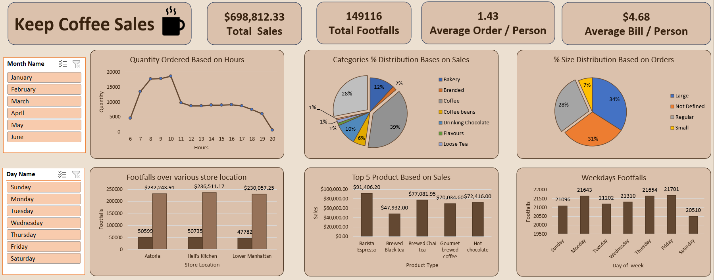

# ☕ Coffee Sales Dashboard | Excel

## 📌 Project Overview
An interactive Coffee Sales Dashboard built using Microsoft Excel to analyze sales performance, customer footfall, product categories, and ordering trends across multiple store locations.

## 🛠️ Tools & Technologies
- Microsoft Excel
- PivotTables & PivotCharts
- Slicers
- KPI Cards
- Data Analysis & Visualization

## 📊 Key Performance Indicators (KPIs)
- **Total Sales:** $698,812.33
- **Total Footfalls:** 149,116
- **Average Order per Person:** 1.43
- **Average Bill per Person:** $4.68

## 📈 Dashboard Features
- Monthly and day-wise sales filtering
- Hourly quantity ordered analysis
- Category-wise sales distribution
- Product size distribution
- Store location performance comparison
- Top 5 products based on sales
- Weekday customer footfall analysis
- Interactive slicers for dynamic filtering

## 🔍 Key Insights
- Total sales reached $698,812.33.
- Coffee accounts for approximately 39% of the displayed category-wise sales distribution.
- Large-size orders contribute approximately 34% of total orders.
- Order quantity peaks around 10 AM in the displayed hourly chart.
- Hell's Kitchen generated approximately $236.5K in sales.
- Astoria generated approximately $232.2K in sales.
- Lower Manhattan generated approximately $230.1K in sales.

*Note: Insights are based on the current dashboard view and may change when filters are applied.*

## 🖼️ Dashboard Preview

Add your dashboard screenshot to the repository and update the image path below.

## 🚀 How to Use
1. Clone or download this repository.
2. Open the Excel workbook in Microsoft Excel.
3. Navigate to the dashboard worksheet.
4. Use the Month Name and Day Name slicers to filter the data.
5. Explore the KPIs and charts to identify sales trends.

## 🎯 Project Objective
To demonstrate practical skills in Excel data analysis, KPI reporting, interactive dashboards, and business insights generation.

## 👤 Author
**Mohammad Shahil Khan**

Aspiring Data Analyst
